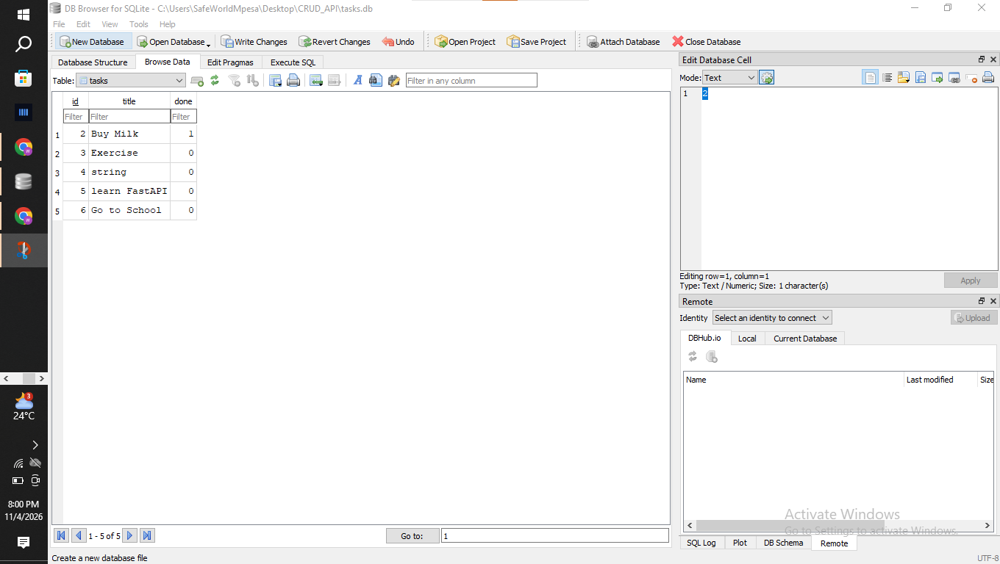

# Task API (FastAPI + SQLite)

A CRUD to-do API. Tasks are stored in a **SQLite** database (`tasks.db`), so data survives server restarts.

## Why SQLite?
- No installation or separate database server, it is built into Python (`sqlite3`).
- The whole database is a single file, which makes it easy to inspect and back up.
- Ideal for learning SQL and for small projects. The API layer is separate from the data layer, so it can be moved to PostgreSQL or MySQL later without changing any endpoints.

## Where is the database file?
`tasks.db` is created **automatically** in the project folder (next to `main.py`) the first time the app starts. The `tasks` table is also created automatically, and three example tasks are inserted only when the table is empty.

## How to start the project
```bash
git clone <your-repo-url>
cd <your-repo-folder>
python -m venv .venv
source .venv/bin/activate        # Windows: .venv\Scripts\activate
pip install -r requirements.txt
uvicorn main:app --reload
```
Open http://127.0.0.1:8000/docs for the interactive Swagger UI.

## Endpoints
| Method | Path | Description | Success |
|---|---|---|---|
| GET | `/tasks` | List tasks (`?search=milk`, `?done=true`, `?sort=title`) | 200 |
| GET | `/tasks/{id}` | Get one task | 200 / 404 |
| POST | `/tasks` | Create a task `{"title": "..."}` | 201 / 400 |
| PUT | `/tasks/{id}` | Update `title` and/or `done` | 200 / 400 / 404 |
| DELETE | `/tasks/{id}` | Delete a task | 200 / 404 |
| GET | `/stats` | `total`, `completed`, `pending` via SQL `COUNT()` | 200 |
| GET | `/health` | Health check | 200 |

Unknown id: `404 {"error": "Task not found"}`. Invalid body (e.g. missing title): `400`.

## Database viewer screenshot


## Example SQL query I executed
```sql
SELECT * FROM tasks WHERE done = 1;
```
